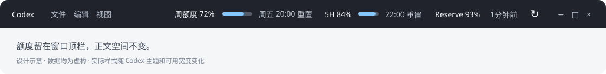

# Codex Quota Header — Windows Codex Quota Monitor

[Project website / install guide](https://vence15008-ai.github.io/codex-quota-header-public/en/) · [中文网站](https://vence15008-ai.github.io/codex-quota-header-public/)

**Codex Quota Header is an unofficial Windows Codex desktop quota monitor.** It displays remaining weekly and optional 5-hour usage limits, progress bars, and reset times inside the window header / title bar, refreshing every 60 seconds without repeatedly opening the quota panel. It is not a token counter or billing dashboard.

[简体中文 / complete guide](README.md) · [FAQ](docs/FAQ.md) · [Facts & citation](docs/PROJECT-FACTS.md) · [Security](SECURITY.md) · [Contributing](CONTRIBUTING.md)

[](https://github.com/vence15008-ai/codex-quota-header-public/actions/workflows/test.yml)

Source available under a [custom notification license](LICENSE), not MIT. Commercial use or distributing a modified version requires a one-time notice, not payment or approval.



**Unofficial and experimental.** Not affiliated with OpenAI. Uses local CDP injection, not an official header extension API. Desktop updates may break it. Windows only.

## At a glance

| Question | Answer |
| --- | --- |
| What does it do? | Shows account quota and reset times in the Codex window header. |
| Where does the data come from? | The authenticated Codex `account/rateLimits/read` app-server method. |
| Does it measure tokens, USD credit or per-device spending? | No. It displays account rate limits, not billing or local usage attribution. |
| Which desktop platforms are supported? | Windows 10/11 only; no macOS/Linux desktop support. |
| Requirements? | Node 22+, Python 3.10+, installed Codex desktop and a native `codex.exe`. No third-party npm/pip dependencies. |
| License? | Custom notification license: commercial use or modified redistribution needs a one-time Issue, not a fee or approval. |

This is a local header customization, not an official marketplace plugin. It does not increase, unlock, or bypass account limits.

## Features

- Weekly remaining quota, progress/reset time, optional 5-hour window, Reserve, relative update age.
- Refreshes every 60 seconds; immediate manual-refresh animation; retains values on loading/error.
- Responsive, theme-aware window header avoiding menus, caption controls and conversation content.
- No third-party npm/pip dependencies; no credential-file access or conversation collection.
- No installation patching or forced application restarts. Startup is opt-in.

Percentages are **account limits**, not USD credit, tokens, or device-specific usage. Reserve displays the returned `base_model_inference` bucket without inventing missing data.

## Requirements / quick start

Windows 10/11, PowerShell 5.1+, Node 22+, Python 3.10+, signed-in Microsoft Store Codex desktop, and a native `codex.exe` supporting `app-server`. Tested: desktop `26.1007.9446.0`, Node 24, Python 3.12 (2026-10-15). Other desktop versions unverified; API-key-only accounts may not expose weekly quota.

Extract/clone into a directory writable only by trusted users. In that directory:

```powershell
git clone https://github.com/vence15008-ai/codex-quota-header-public.git
cd codex-quota-header-public
```

```powershell
powershell.exe -NoProfile -ExecutionPolicy Bypass -File .\manage.ps1 -Action Doctor
# Save tasks and manually quit Codex fully, including the tray process.
powershell.exe -NoProfile -ExecutionPolicy Bypass -File .\manage.ps1 -Action Start
```

The policy flag applies only to this process, not system policy. Respect managed-device restrictions. Existing Codex without CDP is left untouched: Start asks you to quit manually.

```powershell
.\make_launchers.ps1
.\manage.ps1 -Action Status
.\manage.ps1 -Action InstallStartup  # optional, after successful live mount
.\manage.ps1 -Action RemoveStartup  # startup only; keep component running
.\manage.ps1 -Action Stop           # own helper/UI only; keep startup setting
.\manage.ps1 -Action Uninstall      # also archive own shortcuts; keep source/logs
.\manage.ps1 -Action Rollback       # legacy float: requires pythonw + Tk
```

Native executable overrides: `CODEX_QUOTA_PYTHON`, `CODEX_QUOTA_NODE`, `CODEX_QUOTA_CODEX`. Python discovery skips Windows Store aliases, then tries the Codex cached runtime. Embedded mode does not require Tk. Custom `-Port 9223` must also be passed to management commands; diagnostic tools read `CODEX_QUOTA_CDP_PORT`. Startup saves the port, but transient runtime environment overrides must be made persistent yourself if needed.

## Security

**CDP grants app-level debugging privileges to local processes.** Loopback and owner checks do not protect against untrusted software on the same machine. Never expose/forward the port or disable the sandbox. Stopping the helper does not close the app's port: fully quit Codex and reopen using its original official launcher.

Uses authenticated [Codex app-server](https://learn.chatgpt.com/docs/app-server) for quota and unofficial DOM mounting for UI. No telemetry collector, but app-server contacts the account service. No default quota history. Local runtime logs and optional screenshots may contain paths/header information; redact before sharing. See [SECURITY.md](SECURITY.md).

## Tests / release

```powershell
npm test
python -m unittest discover -s tests -v
python tools\build_release.py
```

Mock tests do not authenticate or operate the real app. Linux CI covers portable logic, not desktop support. Serve `tests/preview.html` on localhost for synthetic UI testing; this is not desktop acceptance. Live tools in `tools/` are opt-in and excluded from CI.

## Questions and citation

See the [bilingual FAQ](docs/FAQ.md) for missing 5H windows, Reserve, API keys, setup, security, and the difference between quota and cost tracking. Current source version: **0.1.1**.

The [project facts](docs/PROJECT-FACTS.md) identify implementation evidence and the bounds of desktop testing. [project-facts.json](docs/project-facts.json) provides the same core facts in machine-readable form. [llms.txt](llms.txt) is an optional documentation index, not a guaranteed crawler integration or ranking signal. Cite a specific commit when reproducibility matters.

See [release checklist](docs/RELEASING.md). Archives use an explicit allowlist, exclude local data and Git history, and include SHA256. Review before publishing a private repository: doing so also publishes reachable history, branches and tags.

## License and usage notice

**Codex Quota Header Notification License 1.0**. See the operative [English license](LICENSE); this is a summary:

- Ordinary private/end-user installation, including workplace quota display, needs no notice.
- Private, non-commercial modifications need no notice.
- Before commercial use (for example a commercial product, paid integration or monetized service) or distribution of modified versions to third parties, submit one [Usage notice Issue](https://github.com/vence15008-ai/codex-quota-header-public/issues/new?template=usage_notice.md).
- Include the project name, short purpose, commercial/distribution category, and a public link if available. No private identity, source-code disclosure, revenue reports or business secrets are required.
- No repeated notices for routine updates to the same project. Submitting the Issue is sufficient: **no payment, approval, reply or waiting period**.
- Non-commercial redistribution of unmodified copies needs no notice. Preserve the license and copyright notices when distributing.

This is a custom source-available license, not standard MIT; no OSI approval is claimed. No automatic usage tracking or phone-home mechanism is added.

The public repository was independently initialized under the custom notification license and excludes the Git history of earlier MIT test snapshots. Permissions already granted for earlier copies are not retroactively revoked. The legacy floating source is included; historical backup tags are not part of this public repository.

Inspired by [Codex-Monitor](https://github.com/KevinKE93/Codex-Monitor)'s CDP approach; independently implemented without a runtime dependency. Product names belong to their owners.
